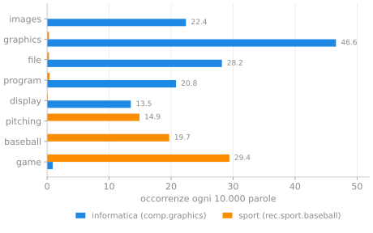
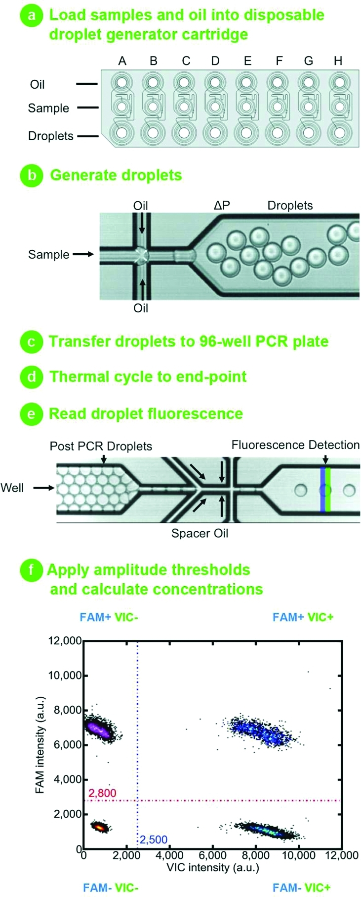
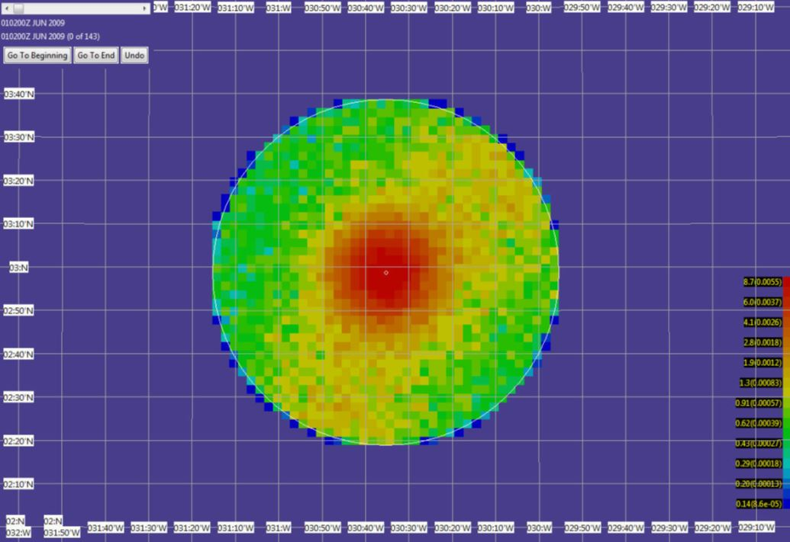
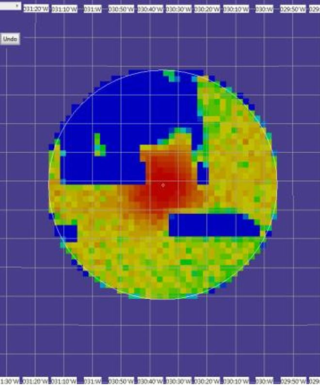

# La probabilità al lavoro

*Cinque problemi di lavoro e i modelli che li risolvono. Una pausa tra un capitolo e l'altro, non un argomento nuovo.*

!!! info "Che cosa trovi in questa pagina"
    Qui non c'è teoria nuova. Ci sono cinque situazioni di lavoro in cui compaiono gli strumenti delle Settimane 1–6. Per ogni caso trovi la domanda, che cosa si osserva, il modello e un conto semplice. Non serve ricordare i numeri: serve riconoscere il tipo di problema.

## Applicazioni reali, numeri quasi sempre inventati {: #reale-inventato }

Le applicazioni sono reali. Non tutte sono però un caso aziendale documentato: per la classificazione dei testi è documentato il metodo e c'è un corpus pubblico di testi veri, non l'uso fatto da una specifica azienda. In quattro casi su cinque i numeri sono inventati, per poter fare i conti a mente e per non dover dipendere da dati riservati. In fondo a ogni caso trovi che cosa viene da una fonte e che cosa è stato costruito per questa pagina.

| Caso | Che cosa è documentato | Che cosa è inventato |
|---|---|---|
| 1. Esperimenti A/B | Bing usava esperimenti controllati su larga scala (Kohavi et al., 2013) | pulsante, 1.000 utenti, 100 contro 112 |
| 2. Classificare testi | il corpus pubblico *20 Newsgroups* e il metodo *Multinomial Naive Bayes* | niente: conteggi e risultato sono calcolati su testi veri |
| 3. DNA | PCR digitale a goccioline Bio-Rad, circa 20.000 gocce (Hindson et al., 2011) | 50% di gocce negative e 13.863 copie |
| 4. Ricerche in mare | ricerca del volo AF447 con il teorema di Bayes (Stone et al., 2014) | esempio con due sole zone |
| 5. Guasti | TI per la distribuzione esponenziale; NSK e SKF per la distribuzione di Weibull e la durata $L_{10}$ | $\lambda=0{,}0001$ ore$^{-1}$ |

In altre parole: **il fenomeno è vero, la storia numerica è didattica**. È lo stesso patto delle dispense, dove gli esempi servono a mostrare il ragionamento e non a sostituire i dati di uno studio. L'unica eccezione è il secondo caso, dove anche i numeri sono presi da un corpus reale e si possono rifare.

## 1. Due versioni della stessa pagina {: #ab }

*Modello: distribuzione di Bernoulli e distribuzione binomiale · Settimane 4–5*

**La domanda.** Una squadra ha reso più visibile il pulsante di ricerca di un sito. Prima di estendere la modifica a tutti gli utenti, vuole sapere se il pulsante aumenta la probabilità che un utente lo usi.

**Che cosa si osserva.** Per ogni utente registriamo un solo esito: ha cliccato almeno una volta, oppure no. Dividiamo gli utenti a caso in due gruppi: A vede la versione attuale, B quella nuova. I due gruppi restano attivi nello stesso periodo. L'unità osservata è l'utente: cinque clic della stessa persona valgono un solo successo.

L'assegnazione casuale non rende i gruppi identici. Serve a evitare che siamo noi a scegliere utenti diversi per A e B. Anche due gruppi casuali, però, possono comportarsi in modo diverso per puro caso.

**Il modello.** Per l'utente $i$ definiamo $X_i=1$ se clicca e $X_i=0$ altrimenti. $X_i$ è una **variabile bernoulliana** con probabilità di successo $p$: è la distribuzione di Bernoulli. Il conteggio dei successi nel gruppo,

$$
S=X_1+\cdots+X_n,
$$

ha una **distribuzione binomiale** di parametri $n$ e $p$. La probabilità $p$ non è nota: la osserviamo attraverso $S$, e la stimiamo con la frequenza

$$
\hat p=\frac{S}{n}.
$$

Qui $p$ è la quantità che ci interessa, $S$ è il numero casuale che vediamo e $S/n$ è la nostra stima.

**Un conto semplice.** Immaginiamo di osservare 1.000 utenti per versione.

| Versione | Utenti | Clic | Frequenza |
|---|---:|---:|---:|
| A | 1.000 | 100 | 10,0% |
| B | 1.000 | 112 | 11,2% |

B ha 12 successi in più, cioè 1,2 punti percentuali. Sembra un vantaggio. Ma quanto possono oscillare i conteggi se le due versioni funzionano ugualmente bene?

Se entrambe avessero davvero $p=0{,}10$, il conteggio di ciascun gruppo avrebbe deviazione standard

$$
\sqrt{1.000\cdot 0{,}10\cdot 0{,}90}\approx 9{,}5.
$$

Per la differenza tra due gruppi indipendenti, la deviazione standard è circa $\sqrt{90+90}\approx 13{,}4$ successi. I 12 successi osservati sono quindi poco meno di una deviazione standard: una differenza del genere può comparire per caso con una certa frequenza. **Il fatto che 112 superi 100, da solo, non dimostra che B sia migliore.**

Questa non è ancora una regola completa di decisione: è il primo passo, quello che dice quanto pesare la variabilità prima di fidarsi di una differenza.

<figure class="psi-figure">
  
  <figcaption>Lo stesso schema, in un esperimento reale di Bing: due versioni dello stesso annuncio, senza e con i <em>site link</em>. Il trattamento aumentò i clic di quasi il 15% ($p=0{,}01$). Figura 1 di Kohavi et al., KDD 2013.</figcaption>
</figure>

**Reale e inventato.** L'uso degli esperimenti A/B a Bing è documentato: Kohavi e colleghi parlano di oltre 200 esperimenti simultanei e di milioni di utenti, e la figura qui sopra è tratta dal loro articolo. Il pulsante di ricerca, i 1.000 utenti e i conteggi 100 e 112 sono invece inventati per questa pagina.

Fonti: [Kohavi et al., 2013](https://exp-platform.com/large-scale/){ target="_blank" rel="noopener" }.

## 2. Come fa un programma a capire di che cosa parla un testo? {: #testi }

*Modello: teorema di Bayes · Settimana 2*

**La domanda.** Un programma riceve messaggi e deve distinguere quelli di argomento informatico da quelli sportivi. Non possiamo elencare tutte le frasi possibili. Possiamo però guardare quali parole compaiono nei testi già classificati.

**Che cosa si osserva.** Usiamo *20 Newsgroups*, un corpus pubblico di messaggi veri dai gruppi di discussione Usenet del 1993. Prendiamo due categorie, `comp.graphics` e `rec.sport.baseball`: 584 e 597 messaggi per addestrare il programma, 389 e 397 messaggi diversi per metterlo alla prova. Da ogni messaggio togliamo intestazioni, righe citate e firme, portiamo tutto in minuscolo e teniamo le parole di almeno due lettere; poi contiamo quante volte compare ogni parola in ciascuna categoria. La frequenza con cui una parola appare diventa una stima della sua probabilità *dentro quella categoria*.

**Il modello.** Il programma non parte dal testo e cerca la categoria. Fa il contrario: per ogni categoria si chiede quanto sono plausibili le parole osservate, e poi confronta le categorie. È qui che entra il teorema di Bayes.

Chiamiamo **peso** di una categoria il prodotto

> **peso** = probabilità iniziale della categoria × plausibilità delle parole.

La probabilità iniziale dice quanto la categoria era frequente prima di leggere il testo. La plausibilità delle parole dice quanto quelle parole sono tipiche della categoria. Per ottenere le probabilità finali si dividono i pesi per la loro somma, così tornano a sommare a 1.

**I numeri veri.** Le due categorie non hanno lo stesso numero di parole (96.719 e 73.771), quindi per confrontarle portiamo le frequenze a 10.000 parole.

<figure class="psi-figure">
  
  <figcaption>Frequenze reali nel corpus di addestramento, per 10.000 parole. Le parole dell'informatica quasi non compaiono nei messaggi sportivi, e viceversa.</figcaption>
</figure>

Il grafico dà la direzione, non il fattore da usare nel conto. Quello lo dà il rapporto tra le due frequenze:

| Parola | Più probabile in | Quante volte |
|---|---|---:|
| images | informatica | 173 |
| graphics | informatica | 120 |
| file | informatica | 73 |
| display | informatica | 52 |
| program | informatica | 40 |
| bits | informatica | 33 |
| pitching | sport | 140 |
| baseball | sport | 184 |

Il rapporto tiene conto di un correttivo: una parola mai vista in una categoria riceve una probabilità piccolissima invece di zero, altrimenti un solo termine sconosciuto azzererebbe tutto il prodotto.

**Un conto semplice.** Ecco un messaggio vero, preso dai testi mai usati per l'addestramento (è in inglese, come tutti gli originali):

> Hi, I'm looking for a program which is able to display 24 bits images. We are using a Sun Sparc equipped with Parallax graphics board running X11. Thanks in advance.

Le due categorie hanno quasi lo stesso numero di messaggi (584 e 597), quindi si parte da un confronto 1 a 1. Poi ogni parola sposta il confronto di un fattore. Le più caratteristiche, qui, sono cinque: «images» ×173, «graphics» ×120, «display» ×52, «program» ×40, «bits» ×33. Moltiplicando:

$$
173\times 120\times 52\times 40\times 33\approx 1{,}4\text{ miliardi}.
$$

Anche lasciando fuori le altre venti parole del messaggio, il confronto è chiuso: è informatica. Il modello assegna una probabilità che, arrotondata, è il **100%**.

**Quanto vale quel 100%?** Sui 786 messaggi di prova il programma ne classifica correttamente 768, cioè il **97,7%**: sbaglia 18 volte. Una probabilità altissima su un singolo testo non è una garanzia di correttezza: è il modello che, con quelle parole, non vede alternative. La qualità si misura su testi nuovi, mai visti durante l'addestramento.

Il modello si chiama *Multinomial Naive Bayes*: «multinomiale» perché usa i conteggi delle parole, «ingenuo» perché le tratta come indipendenti. Nel linguaggio reale una negazione può cambiare il senso dell'intera frase, e il modello non se ne accorge.

**Reale e inventato.** Qui non c'è niente di inventato. Il corpus e i messaggi sono veri, i conteggi sono calcolati su quei testi e il 97,7% è il risultato ottenuto sui 786 messaggi di prova. *20 Newsgroups* è un insieme di dati pubblico, usato da decenni per provare i classificatori di testi: le due categorie, le parole del grafico e il messaggio mostrato sono una scelta di chi scrive, e il valore esatto della percentuale dipende un po' da come si preparano i testi, ma il conto si può rifare.

Fonti: [Lang, 1995 (*20 Newsgroups*)](http://qwone.com/~jason/20Newsgroups/){ target="_blank" rel="noopener" } · [McCallum e Nigam, 1998](https://cdn.aaai.org/Workshops/1998/WS-98-05/WS98-05-007.pdf){ target="_blank" rel="noopener" } · [scikit-learn](https://scikit-learn.org/stable/modules/naive_bayes.html#multinomial-naive-bayes){ target="_blank" rel="noopener" }.

## 3. Contare il DNA senza contarlo {: #dna }

*Modello: distribuzione di Poisson · Settimana 5*

**La domanda.** In una provetta ci sono frammenti di DNA troppo piccoli per essere contati a vista. Il laboratorio vuole sapere quante copie di un certo tratto, il *bersaglio*, erano presenti nel campione.

**Che cosa si osserva.** Il campione viene diviso in circa 20.000 goccioline, prima di amplificare il DNA con la PCR. La PCR è una specie di fotocopiatrice molecolare: produce molte copie di un tratto, così il segnale diventa visibile. Ogni goccia funziona come una piccola provetta separata. Dopo l'amplificazione, lo strumento classifica ogni goccia come positiva o negativa.

Il problema è che una goccia partita con una copia e una partita con quattro copie diventano entrambe positive.

| Copie prima della PCR | Lettura dopo la PCR |
|---|---|
| 0 | negativa |
| 1 | positiva |
| 4 | positiva |

Il numero di gocce positive, da solo, non dice quante copie ci fossero. Nel modello ideale, una goccia negativa ha invece un significato preciso: conteneva zero copie del bersaglio. Sono le gocce vuote a permetterci di contare.

<figure class="psi-figure psi-figure--tall">
  
  <figcaption>Il flusso della PCR digitale a goccioline: campione e olio diventano gocce, la PCR le amplifica, lo strumento legge la fluorescenza e il software risale alla concentrazione. In basso, il grafico separa le gocce positive da quelle negative. Figura 1 di Hindson et al., <em>Analytical Chemistry</em>, 2011.</figcaption>
</figure>

**Il modello.** Se le copie sono distribuite a caso tra molte gocce, il numero $X$ di copie in una goccia si descrive con una **distribuzione di Poisson** di media $\lambda$. In questo modello la probabilità che una goccia sia vuota è

$$
P(X=0)=e^{-\lambda}.
$$

Più copie ci sono, meno gocce restano vuote. Osserviamo la frazione $f_0$ di gocce negative e invertiamo la relazione:

$$
\lambda=-\ln(f_0).
$$

Infine moltiplichiamo $\lambda$ per il numero di gocce: otteniamo una stima delle copie presenti *prima* della PCR.

**Un conto semplice.** Su 20.000 gocce, 10.000 sono negative. Allora $f_0=0{,}50$ e

$$
\lambda=-\ln(0{,}50)\approx 0{,}693.
$$

Il modello stima quindi

$$
20.000\times 0{,}693\approx 13.863
$$

copie iniziali. Le gocce positive sono 10.000, ma le copie stimate sono circa 13.863: alcune gocce positive contenevano più di una copia. Lo $0{,}693$ è una media per goccia, non una frazione di molecola.

**Reale e inventato.** La PCR digitale a goccioline è una tecnica reale: il sistema Bio-Rad descritto da Hindson e colleghi usa circa 20.000 gocce da un nanolitro e la distribuzione di Poisson per risalire alla concentrazione. Anche il laboratorio CCR Genomics del National Cancer Institute usa questi sistemi. La ripartizione 50% negative e 50% positive è invece inventata per l'esempio.

Fonti: [Hindson et al., 2011](https://pmc.ncbi.nlm.nih.gov/articles/PMC3216358/){ target="_blank" rel="noopener" } · [NCI CCR Genomics](https://genomics.ccr.cancer.gov/technologies/droplet-digital-pcr-ddpcr/){ target="_blank" rel="noopener" } · [NHGRI, che cos'è la PCR](https://www.genome.gov/genetics-glossary/Polymerase-Chain-Reaction-PCR){ target="_blank" rel="noopener" }.

## 4. Cercare un aereo in fondo al mare {: #ricerche }

*Modello: teorema di Bayes · Settimana 2*

**La domanda.** Il 1º giugno 2009 il volo Air France 447 precipitò nell'Atlantico. Dopo due anni di ricerche senza esito, restava un problema concreto: in quale zona del fondale conviene cercare adesso?

**Che cosa si osserva.** Una ricerca in mare non è un'ispezione completa. Un sensore può non vedere un oggetto anche quando l'oggetto è lì. L'esito «non abbiamo trovato nulla» dipende da due cose: dove si trova il relitto e quanto era efficace la ricerca in quella zona.

**Il modello.** Gli analisti partirono da una **distribuzione a priori**: una mappa che assegna una probabilità a ogni possibile posizione, usando le informazioni disponibili prima delle ricerche. Poi aggiornarono la mappa con il teorema di Bayes. Per ogni zona il peso diventa:

> **peso** = probabilità iniziale × probabilità di non trovarlo, se è lì.

Infine si divide per la somma dei pesi, così le probabilità tornano a sommare a 1. Il risultato è la **distribuzione a posteriori**.

**Un conto semplice.** Immaginiamo due zone, A e B, con probabilità iniziale 50% ciascuna. Cerchiamo solo in A, con una probabilità di rilevamento del 90% se il relitto è lì. Non troviamo nulla.

| Zona | Prima | Non lo trovo, se è lì | Peso | Dopo |
|---|---:|---:|---:|---:|
| A | 0,50 | 0,10 | 0,05 | 9,1% |
| B | 0,50 | 1,00 | 0,50 | 90,9% |

La somma dei pesi è 0,55. A rimane possibile, ma è diventata molto meno plausibile: una ricerca efficace senza risultato è un'informazione forte. Se la ricerca fosse stata poco efficace, il peso di A sarebbe sceso molto meno.

**Reale e inventato.** La ricerca dell'AF447 è un caso documentato. Metron costruì la mappa a priori combinando scenari e dati, aggiornò la distribuzione dopo le spedizioni del 2009 e del 2010, e la mappa a posteriori guidò la spedizione del 2011, che trovò il relitto. Le due mappe qui sotto sono quelle originali. L'esempio con due sole zone e le percentuali 50%, 90% e 9,1% è invece inventato.

<figure class="psi-figure">
  
  <figcaption>Distribuzione a priori: dove si riteneva più probabile trovare il relitto. Figura 1 di Gurley e Stone, <em>SIAM News</em>, 2016; immagine da Stone et al.</figcaption>
</figure>

<figure class="psi-figure">
  
  <figcaption>Distribuzione a posteriori dopo le spedizioni del 2009 e del 2010: la mappa usata per pianificare la ricerca del 2011. Figura 2 di Gurley e Stone, <em>SIAM News</em>, 2016; immagine da Stone et al.</figcaption>
</figure>

Fonti: [Stone et al., 2014](https://arxiv.org/abs/1405.4720){ target="_blank" rel="noopener" } · [Gurley e Stone, <em>SIAM News</em>, 2016](https://www.siam.org/publications/siam-news/articles/bayesian-search-for-missing-aircraft-ships-and-people/){ target="_blank" rel="noopener" } · [il progetto Metron](https://www.metsci.com/what-we-do/featured-projects/the-search-for-air-france-447/){ target="_blank" rel="noopener" }.

## 5. Quanto dura un componente? {: #guasti }

*Modello: distribuzione esponenziale · distribuzione di Weibull (cenno) · Settimana 6*

**La domanda.** Chi progetta un dispositivo deve stimare quanti componenti saranno ancora funzionanti dopo un certo tempo. Due pezzi dello stesso tipo, usati nelle stesse condizioni, possono guastarsi in momenti diversi. Serve una distribuzione delle durate, non un'unica data di scadenza.

**Che cosa si osserva.** La durata varia da pezzo a pezzo. In alcune fasi della vita di un componente il rischio di guasto è circa costante; in altre, come l'usura, cresce con l'età. Sono due situazioni diverse e richiedono due modelli diversi.

**Il modello.** Quando il tasso di guasto è costante, la durata $T$ segue una **distribuzione esponenziale**. La probabilità di essere ancora funzionanti dopo $t$ è

$$
P(T>t)=e^{-\lambda t},
$$

dove $\lambda$ è il tasso di guasto, per esempio in ore$^{-1}$. La durata media è $1/\lambda$. In questo modello vale l'**assenza di memoria**: sapere che un componente ha già funzionato a lungo non cambia la distribuzione del tempo che gli resta. È un'ipotesi adatta alla fase di vita utile, non a tutta la vita del componente.

Quando invece domina l'usura, il rischio cresce con l'età. In quel caso si usa spesso la **distribuzione di Weibull**, una famiglia più flessibile: con un parametro di forma maggiore di 1 il guasto diventa più probabile man mano che il componente invecchia.

**Un conto semplice.** Prendiamo $\lambda=0{,}0001$ ore$^{-1}$. La durata media è

$$
\frac{1}{\lambda}=10.000\text{ ore}.
$$

La probabilità di funzionare oltre 1.000 ore è

$$
e^{-0{,}0001\times 1.000}=e^{-0{,}1}\approx 0{,}905.
$$

Quindi circa il **90,5%** dei componenti funziona ancora dopo 1.000 ore. Una media di 10.000 ore non significa che ogni pezzo arrivi a 10.000 ore: la media descrive la distribuzione, non il singolo componente.

Nei cataloghi dei cuscinetti si trova spesso la durata $L_{10}$: è la durata entro cui si guasta per fatica il 10% dei cuscinetti nelle condizioni considerate. Il 90% supera quella durata. $L_{10}$ è un *quantile*, cioè una soglia associata a una percentuale della popolazione, non la durata del singolo cuscinetto.

**Reale e inventato.** Texas Instruments documenta l'uso della distribuzione esponenziale per la fase a tasso di guasto costante e della distribuzione di Weibull per i tassi variabili. NSK e SKF descrivono la vita a fatica dei cuscinetti con la statistica di Weibull e con la durata $L_{10}$. Il valore $\lambda=0{,}0001$ ore$^{-1}$, le 10.000 ore e il 90,5% sono inventati per l'esempio.

<figure class="psi-figure">
  
  <figcaption>Danno da fatica (<em>flaking</em>) sulla pista di un cuscinetto. Foto © NSK, dalla <a href="https://www.nsk.com/am-en/tools-resources/knowledge-center/bearing-abcs/dynamic-load-ratings-and-fatigue-life/" target="_blank" rel="noopener">documentazione tecnica</a>.</figcaption>
</figure>

Fonti: [Texas Instruments, <em>Reliability terminology</em>](https://www.ti.com/quality-reliability/reliability/terminology.html){ target="_blank" rel="noopener" } · [NSK, <em>Dynamic Load Ratings and Fatigue Life</em>](https://www.nsk.com/am-en/tools-resources/knowledge-center/bearing-abcs/dynamic-load-ratings-and-fatigue-life/){ target="_blank" rel="noopener" } · [SKF, <em>Bearing life statistics</em>](https://evolution.skf.com/bearing-life-statistics/){ target="_blank" rel="noopener" }.

## Il filo comune {: #filo }

I cinque casi sembrano lontanissimi: un pulsante, un testo, una goccia, un aereo, un cuscinetto. Eppure seguono tutti lo stesso schema:

> Che cosa osservo? Che cosa voglio sapere? Quale modello collega le due cose?

| Se la situazione è… | Il modello del corso è… | Dove |
|---|---|---|
| un solo sì/no per utente | distribuzione di Bernoulli | Settimana 4 |
| quanti successi su $n$ prove | distribuzione binomiale | Settimane 4–5 |
| quanti eventi rari in un intervallo | distribuzione di Poisson | Settimana 5 |
| aggiornare una probabilità dopo un'informazione | teorema di Bayes | Settimana 2 |
| il tempo fino a un guasto | distribuzione esponenziale, o distribuzione di Weibull | Settimana 6 |

La probabilità non decide al posto nostro che cosa misurare. Rende esplicite le ipotesi, permette di calcolare quanto fidarci di un risultato e ci avverte quando il modello è troppo semplice per la domanda che abbiamo in mente. È questo il passaggio che vale la pena portarsi dietro: dal problema al modello, e dal modello alla decisione.

## Fonti e crediti {: #fonti }

- R. Kohavi, A. Deng, B. Frasca, T. Walker, Y. Xu, N. Pohlmann, *Online Controlled Experiments at Large Scale*, KDD 2013.
- K. Lang, *NewsWeeder: Learning to Filter Netnews*, ICML 1995, per il corpus *20 Newsgroups*; A. McCallum, K. Nigam, *A Comparison of Event Models for Naive Bayes Text Classification*, AAAI Workshop, 1998; documentazione di scikit-learn per *Multinomial Naive Bayes*.
- B. J. Hindson et al., *High-Throughput Droplet Digital PCR System for Absolute Quantitation of DNA Copy Number*, *Analytical Chemistry* 83 (2011), pp. 8604–8610; pagina del laboratorio CCR Genomics del National Cancer Institute; glossario NHGRI sulla PCR.
- L. D. Stone, T. M. Kratzke, C. M. Keller, J. P. Strumpfer, *Search for Wreckage of Air France AF 447*, *Statistical Science* 29 (2014), pp. 69–80; J. Van Gurley e L. D. Stone, *Bayesian Search for Missing Aircraft, Ships, and People*, *SIAM News*, 1 novembre 2016.
- Texas Instruments, *Reliability terminology*; NSK, *Dynamic Load Ratings and Fatigue Life*; SKF, *Bearing life statistics*.

**Crediti delle immagini.** La figura dell'esperimento A/B è la figura 1 di Kohavi et al., KDD 2013 (© ACM), riprodotta a fini didattici. Il grafico delle frequenze è stato prodotto per questa pagina dai conteggi del corpus *20 Newsgroups*. Le mappe dell'AF447 sono le figure 1 e 2 di Gurley e Stone, *SIAM News*, 2016, immagini da Stone et al.; le scale cromatiche delle due mappe vanno lette separatamente. La figura della PCR è la figura 1 di Hindson et al., *Analytical Chemistry*, 2011 (© American Chemical Society, articolo *AuthorChoice*). La fotografia del cuscinetto è © NSK, *Dynamic Load Ratings and Fatigue Life*.

*Fonti consultate il 24 ottobre 2026.*
